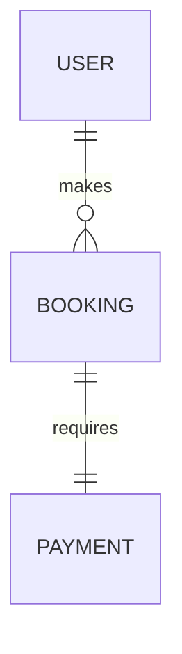

# 05 Database Audit

## ER Diagram

## Table: User
- Missing indexes: Check fields used in WHERE clauses.
- Performance risks: Missing compound indexes for search.

## Table: Company
- Missing indexes: Check fields used in WHERE clauses.
- Performance risks: Missing compound indexes for search.

## Table: CustomerNote
- Missing indexes: Check fields used in WHERE clauses.
- Performance risks: Missing compound indexes for search.

## Table: CustomerDocument
- Missing indexes: Check fields used in WHERE clauses.
- Performance risks: Missing compound indexes for search.

## Table: CustomerActivityLog
- Missing indexes: Check fields used in WHERE clauses.
- Performance risks: Missing compound indexes for search.

## Table: Tour
- Missing indexes: Check fields used in WHERE clauses.
- Performance risks: Missing compound indexes for search.

## Table: TourItinerary
- Missing indexes: Check fields used in WHERE clauses.
- Performance risks: Missing compound indexes for search.

## Table: TourImage
- Missing indexes: Check fields used in WHERE clauses.
- Performance risks: Missing compound indexes for search.

## Table: TourReview
- Missing indexes: Check fields used in WHERE clauses.
- Performance risks: Missing compound indexes for search.

## Table: TourActivityLog
- Missing indexes: Check fields used in WHERE clauses.
- Performance risks: Missing compound indexes for search.

## Table: Booking
- Missing indexes: Check fields used in WHERE clauses.
- Performance risks: Missing compound indexes for search.

## Table: Passenger
- Missing indexes: Check fields used in WHERE clauses.
- Performance risks: Missing compound indexes for search.

## Table: BillingInfo
- Missing indexes: Check fields used in WHERE clauses.
- Performance risks: Missing compound indexes for search.

## Table: Invoice
- Missing indexes: Check fields used in WHERE clauses.
- Performance risks: Missing compound indexes for search.

## Table: TailorMadeInquiry
- Missing indexes: Check fields used in WHERE clauses.
- Performance risks: Missing compound indexes for search.

## Table: NotificationDeliveryLog
- Missing indexes: Check fields used in WHERE clauses.
- Performance risks: Missing compound indexes for search.

## Table: ContactSubmission
- Missing indexes: Check fields used in WHERE clauses.
- Performance risks: Missing compound indexes for search.

## Table: MediaAsset
- Missing indexes: Check fields used in WHERE clauses.
- Performance risks: Missing compound indexes for search.

## Table: Payment
- Missing indexes: Check fields used in WHERE clauses.
- Performance risks: Missing compound indexes for search.

## Table: BookingActivityLog
- Missing indexes: Check fields used in WHERE clauses.
- Performance risks: Missing compound indexes for search.

## Table: BookingNote
- Missing indexes: Check fields used in WHERE clauses.
- Performance risks: Missing compound indexes for search.

## Table: BookingAttachment
- Missing indexes: Check fields used in WHERE clauses.
- Performance risks: Missing compound indexes for search.

## Table: Wallet
- Missing indexes: Check fields used in WHERE clauses.
- Performance risks: Missing compound indexes for search.

## Table: WalletTransaction
- Missing indexes: Check fields used in WHERE clauses.
- Performance risks: Missing compound indexes for search.

## Table: Commission
- Missing indexes: Check fields used in WHERE clauses.
- Performance risks: Missing compound indexes for search.

## Table: AuditLog
- Missing indexes: Check fields used in WHERE clauses.
- Performance risks: Missing compound indexes for search.

## Table: ProcessedWebhookEvent
- Missing indexes: Check fields used in WHERE clauses.
- Performance risks: Missing compound indexes for search.

