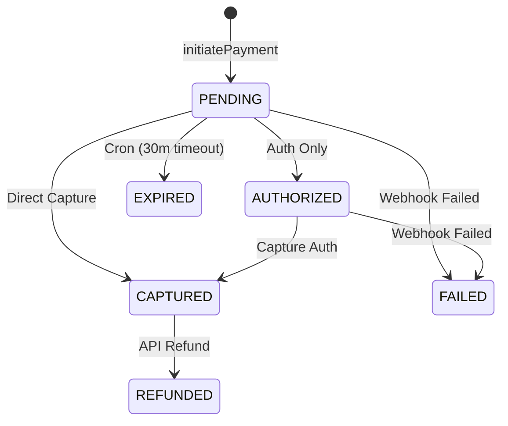

# Payments Module

The payments module handles checkout initiation, webhook processing, refund handling, and payment state management via Domain-Driven Design (DDD).

## Architecture & Integration

The module uses a Ports and Adapters boundary, but **GetPayIn is the only
supported online provider**. The boundary isolates provider HTTP and webhook
details from booking business logic; it is not a provider selector. The
GetPayIn adapter remains fail-closed until the official Direct API contract is
stored under `docs/vendor/getpayin/`.

## Payment Entity State Machine

The strict state transition diagram managed by `PaymentEntity` (`src/modules/payments/domain/payment.entity.ts`):

*Note: Invalid transitions explicitly throw an `InvalidPaymentTransitionException`.*

## Idempotency & Concurrency Safety

Webhook idempotency is guaranteed via the `ProcessedWebhookEvent` table. Webhooks are processed within a Prisma `$transaction` using the **`Serializable`** isolation level to protect against concurrent webhook deliveries.

If two identical webhooks arrive simultaneously, exactly one will commit and the other will fail safely, returning `200 OK` without duplicating side-effects.

## Current Limitations
- **Partial Refunds**: Not currently supported. The `Payment` schema does not track `amountRefunded`. Calling `POST /payments/:id/refund` with a partial amount will throw a `BadRequestException`.

## Payment Webhook Testing

Payment webhooks are processed at `POST /payments/webhook/getpayin`.
The system validates signatures and records transactions idempotently in the `ProcessedWebhookEvent` table.
