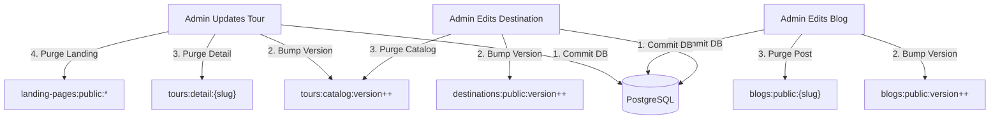

# Dunas Travel — Cache Invalidation & Consistency Strategy
**Document Reference**: `DOC-OPS-INV-003`  
**Classification**: Production Engineering Specification  
**Version**: 2.0  
**Status**: ACTIVE & VERIFIED  

---

## 1. The Invalidation Challenge

In high-concurrency luxury travel platforms, cache invalidation is historically prone to two severe failure modes:
1. **The Stale Luxury Hazard**: An administrator updates a tour price, itinerary, or hotel accommodation in the CMS, but prospective travelers continue seeing outdated prices or deleted departures for hours.
2. **The Wildcard Invalidation Hazard**: Traditional cache implementations attempt to purge keys using `KEYS tours:*` or full pattern scanning. In Redis, `KEYS` is an $O(N)$ synchronous command that freezes the single-threaded Redis event loop, causing latency spikes and connection dropouts.

To eliminate both hazards, Dunas Travel implements **Atomic Versioned Namespacing** alongside **Event-Driven Granular Eviction**.

---

## 2. Core Mechanism: Atomic Versioned Namespacing

Rather than deleting hundreds of individual cache keys across multiple filter permutations (`category=Classic`, `destination=egypt`, `sortPrice=asc`, `page=1..10`), the catalog uses an atomic version pointer:

```
tours:catalog:version ──► Integer (e.g., 4)

Keys stored in cache:
├── tours:catalog:v4:e3b0c44298fc1c149afbf4c8996fb92427ae41e4...
├── tours:catalog:v4:8f434346648f6b96df89dda901c5176b10a6d839...
└── tours:catalog:v4:fa2c64b6330058b88eb3a6946684aa59050d276b...
```

### Invalidation Workflow for Tour Updates (The "Tour 123" Problem):
Suppose Tour 123 is updated by an administrator. In an un-versioned cache, the system would need to track and delete:
* `dunas:tour:123`
* `dunas:tours:list:page1`
* `dunas:tours:list:popular`
* `dunas:tours:list:destination:egypt`
* `dunas:tours:list:category:luxury`
* Hundreds of other price, duration, and locale filter combinations.

Manually maintaining registries or executing pattern scans (`KEYS *` or `SCAN`) is fragile and causes severe Redis latency spikes.

**Under Atomic Versioning**:
1. An administrator edits, creates, or archives Tour 123 via the Admin Dashboard (`PATCH /api/tours/123`).
2. The service executes the database transaction in PostgreSQL.
3. Upon commit, `ToursService.bumpCatalogVersion()` is invoked.
4. The version key `tours:catalog:version` is atomically incremented:
   $$\text{version} \gets \text{version} + 1 \quad (4 \to 5)$$
5. The specific tour detail key `tours:detail:v4:tour-123:*` is purged.
6. **Instant Multi-List Invalidation**: Immediately, all incoming catalog queries look for keys with prefix `tours:catalog:v5:*`. All list permutations (`page1`, `egypt`, `luxury`) automatically miss and are lazily recomputed and cached under `v5`. The old `v4` keys become unreferenced and are naturally reclaimed by the LRU memory manager or Redis TTL expiration.
7. **Execution Cost**: Exactly **1 atomic integer increment** ($O(1)$) instead of scanning and deleting thousands of keys ($O(N)$).

---

## 3. Entity-to-Cache Invalidation Matrix

| Trigger Event | Originating Action | Affected Cache Namespaces | Invalidation Technique |
| :--- | :--- | :--- | :--- |
| **Tour Created / Updated / Deleted** | Admin CMS mutation | `tours:catalog:v*`, `tours:detail:*` | `bumpCatalogVersion()` + specific slug eviction |
| **Tour Landing Page Modified** | Admin Page Editor | `landing-pages:public:v*`, `tours:catalog:v*` | Version bump + landing page cache eviction |
| **Blog Post Published / Edited** | Marketing Team CMS | `blogs:public:v*`, `blogs:detail:*` | Version bump (`bumpBlogVersion()`) |
| **Destination Info Updated** | Content Admin | `destinations:public:v*` | Version bump (`bumpDestinationsVersion()`) |
| **New Tour Review Approved** | SRE / Moderator | `tours:reviews:{tourId}` | Direct key eviction (`cache.del`) |
| **Exchange Rate Refresh** | Automated Currency Cron | `currency:rates:latest` | Direct overwrite with new 1-hour TTL |
| **Emergency Global Purge** | SRE Runbook Action | All Namespaces | Admin Cache Flush Endpoint (`POST /api/admin/cache/flush`) |

---

## 4. Cross-Domain Invalidation Dependency Graph

When content in one domain affects multiple public representations, invalidation cascades deterministically:



---

## 5. Edge & CDN Revalidation (RFC 7234)

In addition to backend application-level invalidation, the Edge CDN layer (Cloudflare / Vercel) and browser caches must synchronize:

1. **Short Browser TTL**:
   * `Cache-Control: max-age=60` guarantees that a client browser never holds content for more than 60 seconds without revalidating with the origin.
2. **Surrogate CDN TTL**:
   * `s-maxage=300` instructs the CDN edge to keep content for up to 5 minutes.
3. **Stale-While-Revalidate**:
   * `stale-while-revalidate=600` allows the CDN to serve a cached response to the client immediately while asynchronously fetching the updated version from the backend origin in the background.
4. **Conditional Revalidation**:
   * When `If-None-Match: <etag>` is sent, if the version bumped, the hash changes, and the backend immediately sends `HTTP 200` with fresh data and a new ETag. If the content is identical, the backend responds with `HTTP 304 Not Modified` (0 bytes body).
