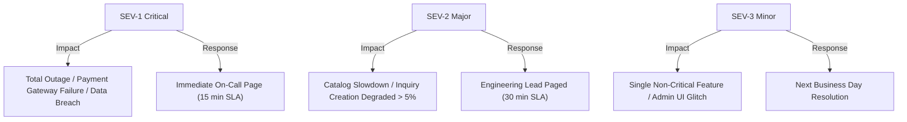

# Production SRE Runbook & Operational Standard Operating Procedures (SOP)
**System**: Dunas Travel Production Ecosystem  
**Target Environment**: Production Multi-Cloud (Vercel Edge, Node.js API, Neon Serverless PostgreSQL, Cloudinary)  
**Version**: 1.0.0-GA  
**Date**: September 20, 2026  
**Auditor**: Principal Site Reliability Engineer  

---

## 1. Service Level Objectives (SLO) & Error Budgets

| Service Indicator (SLI) | Production Target (SLO) | Measurement Window | Error Budget |
| :--- | :--- | :--- | :--- |
| **API Availability** | **>= 99.9%** | 30 Days (Rolling) | 43.8 minutes downtime |
| **Catalog Read Latency (WAN)** | **P95 < 2,500 ms** | 1 Hour | 5% exceeding threshold |
| **Inquiry Submission Latency** | **P95 < 3,500 ms** | 1 Hour | 5% exceeding threshold |
| **HTTP 5xx Server Error Rate**| **< 0.1%** | 1 Hour | 1 in 1,000 requests |

---

## 2. Incident Severity Classification Matrix



---

## 3. Incident Triage & Emergency Playbooks

### SOP-01: Database Connection Pool Exhaustion (Pool Timeout / 503)
- **Symptoms**: Sentry reports `P2024: Database connection pool timeout`, API latency spikes to > 10s.
- **Immediate Action**:
  1. Inspect Neon Web Console (`https://console.neon.tech`).
  2. Check current active connections against the 20-connection pool limit.
  3. Identify long-running queries via SQL:
     ```sql
     SELECT pid, now() - pg_stat_activity.query_start AS duration, query, state
     FROM pg_stat_activity
     WHERE state != 'idle' AND (now() - pg_stat_activity.query_start) > interval '5 seconds';
     ```
  4. Terminate blocking or deadlocked queries if necessary:
     ```sql
     SELECT pg_terminate_backend(<pid>);
     ```
  5. If continuous legitimate surge: In Neon console, scale compute from 0.5 CU to 2.0 CU and increase `connection_limit` in environment variables.

### SOP-02: Flash Traffic Surge & CPU Saturation
- **Symptoms**: Container CPU usage > 85%, response times degrade across all endpoints.
- **Immediate Action**:
  1. Enable Cloudflare Under Attack Mode at Edge if traffic is illegitimate/botnet.
  2. Scale backend container replicas from 1 to 3 instances in Railway / AWS ECS console.
  3. Enable Redis Catalog Cache to offload 90% of catalog queries from the database.

### SOP-03: Webhook Verification Failure / Payment Gateway Disruption
- **Symptoms**: Customer completes payment but booking status remains `PENDING_PAYMENT`.
- **Immediate Action**:
  1. Check Sentry for `HMAC verification failed` or gateway network timeouts.
  2. Verify webhook secret rotation in environment variables.
  3. Query pending payments requiring manual reconciliation:
     ```sql
     SELECT id, reference_code, total_amount_usd, created_at 
     FROM bookings 
     WHERE status = 'PENDING_PAYMENT' AND created_at < NOW() - INTERVAL '15 minutes';
     ```
  4. Concierge operations initiates manual verification with payment gateway dashboard and updates booking status to `CONFIRMED`.

---

## 4. On-Call Roster & Communication Channels

- **Primary SRE On-Call**: PagerDuty Escalation Policy `dunas-prod-critical`
- **War Room Channel**: `#incident-war-room` (Slack)
- **Status Page**: `https://status.dunastravel.com`
- **Customer Support Hotline**: VIP Concierge 24/7 Desk

---

## 5. Post-Incident Review (PIR) Policy

A blameless Post-Incident Review must be authored and published within **48 hours** for any SEV-1 or SEV-2 incident.
- **Template**:
  1. Incident Summary & Timeline
  2. Root Cause Analysis (5 Whys)
  3. Impact Analysis (Users affected, error budget consumed)
  4. Corrective Action Items with assigned owners and Jira ticket links.
