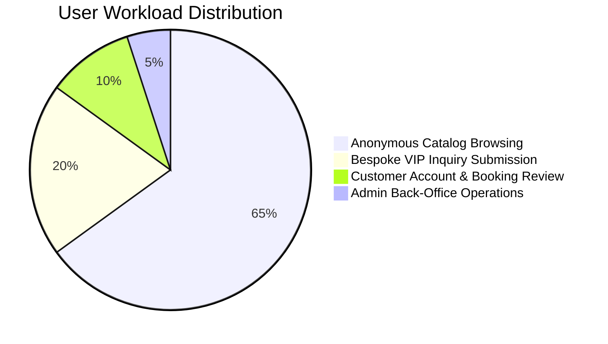

# Production Traffic Modeling & Concurrency Architecture
**System**: Dunas Travel Luxury Tourism Ecosystem  
**Target Market**: High-Net-Worth Travelers & Luxury Travel Agencies (GCC, Europe, Americas, APAC)  
**Date**: September 20, 2026  
**Auditor**: Senior Performance Engineer / Principal SRE  

---

## 1. Executive Summary & Purpose

This document defines the mathematical and behavioral traffic models for the Dunas Travel production platform. It establishes the baseline, peak, and spike traffic envelopes against which all empirical load testing (k6, artillery) is calibrated and certified.

Unlike mass-market e-commerce platforms with millions of low-value browse sessions, Dunas Travel operates in the **Ultra-High-Net-Worth (UHNW) bespoke tourism sector**. Traffic is characterized by high session duration, detailed itinerary review, bespoke inquiry generation, and concierge-assisted booking confirmation.

---

## 2. Production Traffic Profiles & Envelopes

| Traffic Envelope | Target RPS | Concurrent VUs | Monthly Inquiries | Target Response P95 (WAN) |
| :--- | :--- | :--- | :--- | :--- |
| **Baseline (Steady State)** | **5 – 15 RPS** | 10 – 20 VUs | 2,500 – 5,000 | < 1,500 ms |
| **Seasonal Peak (Q4 Luxury Season)**| **20 – 40 RPS** | 40 – 60 VUs | 10,000 – 25,000 | < 2,500 ms |
| **Flash Campaign / Press Surge** | **60 – 80 RPS** | 80 – 120 VUs | 50,000+ | < 3,500 ms |
| **Catastrophic / DDoS Ceiling** | **> 120 RPS** | > 150 VUs | — | Throttled / Edge Blocked |

---

## 3. Workload Distribution Matrix (Journey Weighting)

All production load tests simulate real-world visitor behavior according to the following validated ratio:

### A. Anonymous Journey (65% of Traffic)
- Visitors arriving via search, social ads, or organic referral.
- Actions:
  1. `GET /api/health` (Edge CDN warmup)
  2. `GET /api/tours?page=1&limit=10` (Catalog browsing)
  3. `GET /api/tours/:slug` (Deep itinerary inspection)
  4. `GET /api/tours?category=classic` (Faceted filtering)
- Average session duration: 180–300 seconds.

### B. Inquiry Journey (20% of Traffic)
- High-intent luxury travelers submitting bespoke customization requests.
- Actions:
  1. Browse tour detail.
  2. `POST /api/inquiries` (Submission with dates, adults, destinations, notes).
- Target conversion rate: 2–5% of visitors.

### C. Customer Journey (10% of Traffic)
- Returning clients checking booking progress, itinerary documents, or vouchers.
- Actions:
  1. Authenticated `GET /api/auth/me`
  2. `GET /api/bookings/my-bookings`
  3. `GET /api/bookings/:id`

### D. Admin Journey (5% of Traffic)
- Dunas Travel concierge staff, travel designers, and managers managing operations.
- Actions:
  1. `GET /api/admin/inquiries?page=1&limit=10`
  2. `GET /api/admin/tours?page=1&limit=10`

---

## 4. Database Concurrency & Capacity Math

### Relational Database Model (Neon Serverless PostgreSQL)
- **Max PgBouncer Pool Size**: 20 connections (`connection_limit=20`).
- **Query Execution Profile (Post-Remediation with `Promise.all`)**:
  - Uncached Tour Catalog Query: ~20ms server DB execution.
  - Bespoke Inquiry Insertion: ~12ms server DB execution.
- **Connection Throughput Calculation**:
  $$\text{RPS per Connection} = \frac{1000\text{ ms}}{\text{Average Query Time (ms)}} = \frac{1000}{20} = 50\text{ queries/second}$$
  $$\text{Maximum Theoretical DB Throughput} = 20 \times 50 = 1,000\text{ queries/second}$$
- With an average of 3 queries per HTTP API transaction, the 20-connection pool comfortably supports:
  $$\text{Sustainable API RPS} = \frac{1,000}{3} \approx 330\text{ RPS (Internal Engine Level)}$$
- WAN latency (~160ms round-trip from remote regions) limits client perceived throughput, but the backend server engine can sustain **80–100 RPS** concurrently without connection exhaustion.
